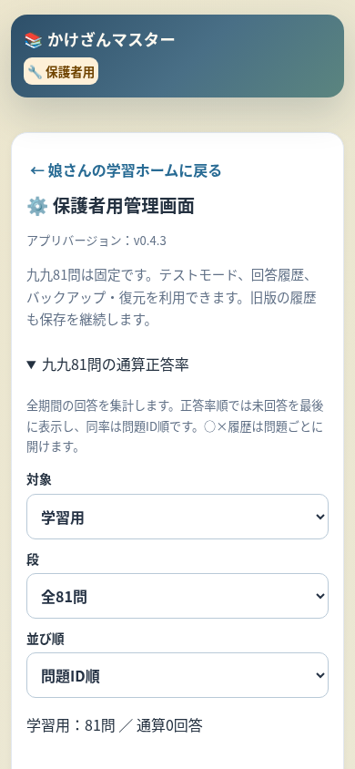
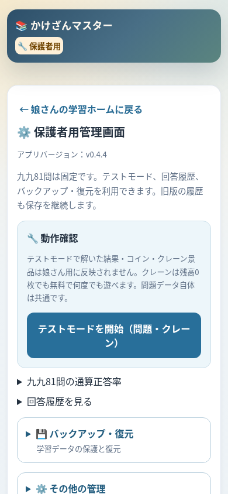
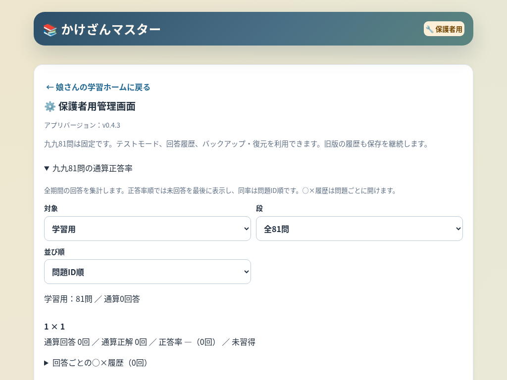
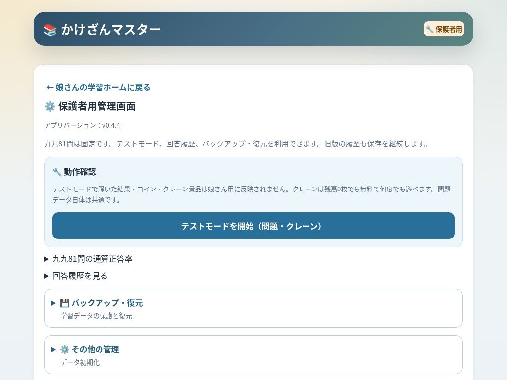

# 管理画面の表示順序・通算正答率の初期状態（v0.4.4候補）

## 基準と変更

- 開始時のGitHub main：`68916109e584db434c3d74e04974c544bb77c0f5`、v0.4.3。PR #8マージ済み、open Issue／PRなし。新Issueは作成しない。
- 作業ブランチ：`codex/admin-order-collapsed-report`。候補版v0.4.4。
- 実行コードの差分は `index.html` の管理画面HTML、通算正答率のselectの最小高さCSS 1行、APP_VERSIONだけ。「動作確認」のブロックを先頭へ移動し、`details#learning-report` の `open` を削除。
- 説明文と「テストモードを開始（問題・クレーン）」ボタン、回答履歴、バックアップ・復元、その他の管理は保持。
- `renderLearningReport()` は親detailsの開閉状態を変更しないため、toggleイベントを含めJavaScriptの調整なし。同じページ内の再描画・画面往復でもユーザーの選択を保持する。新たな開閉状態の永続保存は追加しない。
- 学習問題・報酬・カード・クレーン・ランナー・保存形式の変更なし。DB `kakezan-master-v1` schema12、backup `kakezan-master-backup` v12、17ストアを維持。`runner/**`、`assets/**` の差分なし。

## ローカル検証

Python 3.12.14、Playwright 1.62.0、Chromium 156.0.8078.79（Linux）、Node.js v24.22.3。一時ブラウザコンテキストと架空データのみ使用。

| コマンド（unittestは `PYTHONPATH=tests python -m unittest -v`） | 結果 |
|---|---|
| `progress_cards_test mobile_regression_test quiz_prompt_test` | 16件合格 |
| `admin_report_test locked_card_test multiplication_test positive_coin_reward_test app_isolation_test app_version_test table_coin_reward_test` | 48件合格（164.061秒） |
| `python scripts/check_static.py` | 合格：HTML参照、親／runnerのJS構文、アプリ識別子 |
| `python -m compileall -q tests scripts` | 合格 |
| `git diff --check` | 合格 |
| `python scripts/check_app_version.py --base origin/main --head HEAD` | 合格：v0.4.3 → v0.4.4、アプリ変更1ファイル |

最終結果は64固有テストID合格、不合格0、skip 0。初回の追加テスト1件はカードプレビューを管理画面直下と誤認した期待値で失敗したため、実際の「その他の管理」配下という階層に合わせて修正し、4件すべての再実行合格を反映した。製品コードをこの試験修正で変更していない。

追加の `admin_report_test` は4件。管理メニュー順、初回閉鎖、タップ開閉、Enter／Spaceとフォーカス、81問表示、`renderLearningReport`／`refreshDashboardStay`／`reconcilePage` と画面往復での開閉状態保持を検査。開始・終了操作でstudent/testが切り替わり、閉鎖・開閉・履歴閲覧・他管理メニュー操作によって17ストアの全レコードが変わらないことを検証する。

表示は320×568、568×320、375×667、667×375、390×844、844×390、768×1024、1024×768、820×1180、1180×820、507×768、320×1024の12サイズ。文字100%／CSS200%・閉鎖／展開の48条件で順序、横はみ出しなし、対象ボタン・見出し・selectの44px以上を確認する。

既存の `progress_cards_test`、`mobile_regression_test`、`quiz_prompt_test` は見出しを明示的に開いてから検査する。既存assertは削除せず、通算25件（正解5件、20%）の全○×履歴、同率のID順、未回答末尾、段別9件、両プロフィール、81問の検査を維持する。版検査の期待値だけv0.4.4に更新。新テストはApp isolationのCI対象へ追加する。

CI初回は追加レイアウト試験の文字100%・展開時12条件で44px判定が不合格（他の順序・横幅検査は合格）。既存のselectスタイルに最小高さがなかったため、`#learning-report select { min-height:44px; }` を1行追加して明示する。44pxのassertや既存の検査は弱めない。CIと同じChrome 151.0.7922.34でも追加4件＋既存の集計・履歴1件を再実行し、5件合格（13.602秒）。最終headのCI結果はPR本文に記録する。

全リポジトリの全テスト合格を意味しない。過去工程の既知不合格と実機残件は [PR-4報告](PR4_REPORT.md) を参照。

## 変更前後のスクリーンショット

同じ空の一時DB、Chromium、文字100%、スクロール最上部、同じビューポートで撮影。画像は公開可能な初期画面のみ。

| サイズ | 変更前 v0.4.3 | 変更後 v0.4.4 |
|---|---|---|
| 390×844 |  |  |
| 1024×768 |  |  |

[変更後、見出しを開いた画面（390×844）](images/admin-report/after-open-390x844.png)。変更前は81問の一覧が先に画面を占めていたが、変更後は動作確認の説明と開始ボタンへ先にアクセスできる。

## GitHub Actionsと未実施項目

PR作成後にApp isolation／App version／Runner iframe layoutの結果をPR本文へ記録する。

**iPhone／iPadのSafari実機確認は未実施。** 上記のChromiumサイズ再現・CSS文字200%は実機Safariの代替ではない。実機の縦横、iPad Split View、OS文字拡大、アドレスバー伸縮、VoiceOverは [Safariチェックシート](SAFARI_DEVICE_CHECKLIST.md) に従って別途確認する。

mainへの直接push、マージ、タグ作成、Pages公開・設定変更、歴史マスターの変更は行わず、ドラフトPRで停止する。
