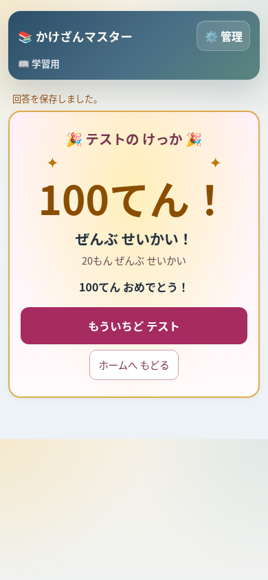
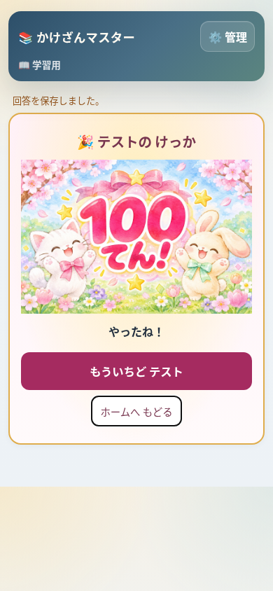

# Issue #14：100点ごほうびイラスト（v0.4.9候補）

Refs #14

## 基準と変更範囲

- 開始時の最新main：`fbbc6a235babe16c2e59ab0152df74e8ec16b7bd`、APP_VERSION `v0.4.8`。Issue #14/#15、PR #11〜#13・#16を再確認し、PR #16マージ済み・open PRなしを確認。AGENTS.md、要求仕様、設計判断を確認。
- 専用ブランチ：`codex/issue-14-perfect-reward`。候補版 `v0.4.9`。結果表示、画像、関連テスト、仕様・検証資料を変更。
- 既存の20問テスト・全20問正解の判定を維持。「🎉 テストの けっか」→承認済み画像→「やったね！」→再挑戦→ホームの順に表示。
- 画像外の大きな得点、「ぜんぶ せいかい！」「20もん ぜんぶ せいかい」「100てん おめでとう！」と金色の星・星の動きを除去。桜色・金色の背景を維持。
- 通常の保存完了通知は既存どおり。保存エラー等の通知処理に変更なし。

## 使用画像

2026-11-25にユーザーが採用承認した添付ZIPのWebPをそのまま使用。デザイン変更・再生成・再圧縮なし。

| 項目 | 値 |
| --- | --- |
| 配置 | `assets/rewards/kakezan_100ten_reward.webp` |
| 形式・寸法 | WebP、1536×1024px、3:2 |
| サイズ | 388,296 bytes |
| WebP SHA-256 | `3d4f0f8db1687510a668bdc8fce007dee215d195c84a5f409876168ff7236375` |
| ZIP SHA-256 | `f3abd307c7afcad02f6262a7f5ce9d0acfb5f3ddebc048dfff523c16891a6c3d` |
| 元画像 | ZIP内 `kakezan_100ten_reward.png`（アプリには追加しない） |

ZIPエントリと配置ファイルのバイト一致、WebPデコード・寸法、実画像を確認。テストでも正本ハッシュとブラウザの自然寸法を検証する。

## 表示・アクセシビリティ

- 満点時だけimgを生成。3:2領域・width/height属性で読み込み前から空間を確保し、`object-fit:contain`で画像全体を表示する。通常幅は最大576px。低い横画面では75svhでも幅を制限する。コンテンツを切り捨てず、必要ならページ全体を縦スクロールする。
- alt：「100点満点！20問すべて正解です。猫とうさぎがお祝いしています。」。画像外に同じ得点・正解数を残さない。
- 読み込み失敗時はimgを除去し、「100てん！」の表示と「100点満点！20問すべて正解です。」の読み上げ名を持つ代替要素1つに置き換える。画像と大きな得点を同時表示しない。
- Chromiumのアクセシビリティツリーで、成功・404のどちらも得点と全問正解の読み上げ情報が1か所であることを確認。VoiceOver実機確認とは区別する。

## 維持事項

100点未満では画像DOMなし。85点は3件、95点は1件、0点は20件の誤答を出題順に、正しい式と答えで表示する。既存の励まし文言・旧10問mix・苦手克服の結果も維持。

81問の等確率抽選、20問・1問5点、採点・習得・段別コイン報酬、学習履歴、中断・再開・再挑戦、結果再表示、達成カード・九九ひょう・保護者画面は変更しない。画像による追加報酬なし。DB `kakezan-master-v1`、schema12、backup12、17ストアを維持。クレーン・ランナーとiframe、歴史マスターの変更なし。runnerと既存ワークフローの差分はゼロ。

## 局所テスト

Linux、Python 3.12.14、Playwright 1.62.0、Chromium 156.0.8078.79、Node v24.22.3。一時ブラウザcontextと架空の学習記録だけを使用。実学習データは含めない。

```sh
KAKEZAN_EXAM_EVIDENCE=/tmp/issue14-after PYTHONPATH=tests python -m unittest -v \
  multiplication_exam_test \
  multiplication_test.MultiplicationTest.test_mix_twenty_unique_and_explicit_next \
  app_isolation_test.AppIsolationTest.test_same_origin_isolation_reload_and_new_database_only \
  app_version_test
python scripts/check_static.py
python -m compileall -q tests/multiplication_exam_test.py tests/multiplication_test.py tests/app_isolation_test.py
git diff --check
python scripts/check_app_version.py --base origin/main --head HEAD
```

**21固有IDが最終合格、skipなし。** 最初の21件実行では20件成功・画面サイズ試験1件エラー（75.763秒）。画面測定の遷移だけを修正後、その1件が36.928秒で合格。他20件のコードはその後変更していない。全21件を一括再実行して合格したという意味ではない。

- 実際の20問を採点し、20問正解で100点の画像、17問正解で85点、19問で95点、10問で50点、0問で0点を確認。既存の20問一意性・明示的な次へ・採点・保存とバックアップ検証を維持し、満点時の期待表示だけを新仕様に合わせた。
- 100点の重複テキストと星がなく、画像と短いメッセージ・操作のみであることを確認。
- 画像リクエストを保留して読み込み前の画像領域・ボタン位置を測定し、読み込み後と完全一致。404、正常表示への復帰、適切なalt、アクセシビリティツリーの重複なしを確認。
- リロード・ホームからの結果再表示・バックアップ往復・プロフィール切替後も満点画像が表示される。閲覧前後の17ストア完全一致、通常の再挑戦、中断再開、二重採点と追加コイン防止、旧10問と苦手克服の表示を確認。
- 10画面サイズ×文字100%／200%×ホーム／85点／0点／100点の**80条件**、うち満点20条件。3:2・contain・幅上限、横はみ出しなし、縦スクロールで画像全体とボタンへ到達できることを検査。[測定JSON](issue14-evidence/metrics.json)。サイズは390×844、844×390、768×1024、1024×768、320×568、375×667、507×768、820×1180、1180×820、667×320 CSS px。
- 初回の画像試験はプロフィール切替後の描画待機不足で失敗し、結果sectionの可視待機を追加して合格。画面サイズ試験は667×320・文字200%の既存stickyヘッダーがホームカード中心の自動クリックを遮りタイムアウトした。画面測定への移動をフォーカス＋Enterに変更。ヘッダーの実装、ポインター・タッチ専用試験、各サイズの表示検査は変更していない。この極端な条件のホームカード中心へのポインター操作を合格とは扱わない。
- 静的検査・対象Python構文・差分空白検査が合格。コミット後の版比較もv0.4.8→v0.4.9、アプリ変更2ファイルで合格。無関係な全面回帰・ゲーム物理のローカル追加試験は実施しない。

## 画面比較

Chromium、文字100%、架空の20/20正解。画像はfull_pageで撮影しているため、横画面ではスクリーンショット全高がviewport高より大きい。必要な縦スクロールを含む記録であり、初期表示に全内容が収まることを意味しない。

| 画面 | 変更前 v0.4.8 | 変更後 v0.4.9候補 |
| --- | --- | --- |
| iPhone縦 390×844 |  |  |
| iPad縦 768×1024 | [変更前](issue14-evidence/before-100-768x1024.png) | [変更後](issue14-evidence/after-100-768x1024.png) |
| iPhone横 844×390 | — | [変更後](issue14-evidence/after-100-844x390.png) |
| iPad横 1024×768 | — | [変更後](issue14-evidence/after-100-1024x768.png) |

iPhone縦・横とiPad縦の画像を目視し、「100てん！」、猫とうさぎ、上下左右の絵が切れず、操作と重ならないことを確認した。

## GitHub Actions・実機未確認

既存必須ワークフロー（App isolation／App version／Runner iframe layout）を維持。このテストは既存App isolationに含まれるモジュール内で実行される。PR作成で起動し、当該headの結果・実行URLをPR本文へ記録する。ローカル合格とCI合格は区別する。

Safari実機・WebKit・VoiceOverは未確認。実機のWebP表示・失敗時代替・発音と重複読み上げ、縦横回転、Safe Area、アドレスバー伸縮、iPad Split View、OS文字拡大、実タップ・ピンチ、アプリ切替と再表示は別途確認が必要。

ドラフトPRで停止。main直接push、マージ、タグ、公開設定変更、Issueのクローズ、歴史マスターの変更は行わない。
