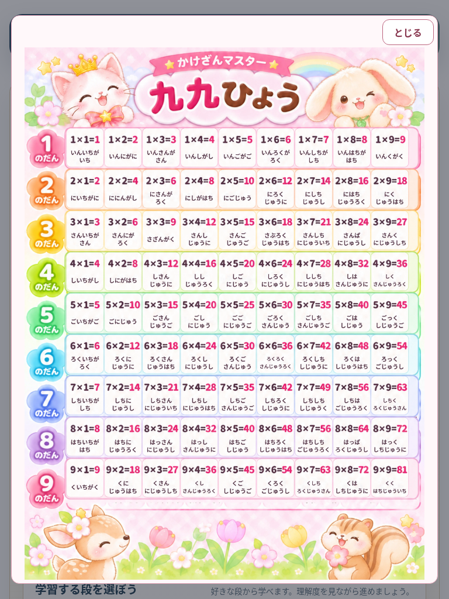

# 九九ひょうのホームボタン・モーダル（v0.4.5候補）

## 基準と範囲

- 開始時main：`a9c1c899038c8341d66e6575fa7e27e83adaceae`（v0.4.4）。GitHub APIとcloneのHEADが一致。PR #9は2026-11-23 13:17:39 UTCにマージ済み。PR #1〜#9はすべてマージ済み、open Issue／PRなし。
- 専用ブランチ：`codex/kuku-chart-dialog`。候補v0.4.5。AGENTS.md、要求仕様、設計判断を確認し、READMEと要件・設計記録を更新。
- 実装は `index.html` の局所CSS、ホームボタン、dialog、読み上げテキスト、開閉処理、画面遷移時の閉鎖、APP_VERSION。学習・報酬・ゲーム・管理の処理は変更しない。
- DBスキーマ12、バックアップ12、17ストアは維持。既存の厳密な版期待値1か所をv0.4.5へ追従。既存必須Actionsを維持し、App isolationへ局所試験を追加（skip・削除・assert緩和なし）。

## 素材の検証

受領ZIP：`1-kakezan_kuku_chart_sakura_readings_corrected.zip`。

| 項目 | 検証結果 |
|---|---|
| 配置 | `assets/kuku/kuku-chart.webp` |
| 元ファイル | `kakezan_kuku_chart_sakura_readings_corrected.webp` |
| SHA-256 | `c4ffd8a6cf4ea01bb3a7a1c389b7a75250a8d1f8a311ba9b8ea3805d8044ef42`（指定値・元ZIP・HTTP配信画像の一致） |
| 寸法・形式 | 2172×2896px、横3:縦4、WebP、ブラウザdecode成功 |
| 容量 | 887,068 bytes |
| 加工 | 再生成・色変更・文字修正・再圧縮なし。元バイト列をコピー |
| PNG | リポジトリへの追加なし |
| JSON | 提供原文を `docs/kuku_readings_verified.json` へ保存。81件、ID一意、順序付き1〜9×1〜9の全組合せ、積・expression・display_lines連結とreadingの一致を検査 |

JSONのIDは教材検証資料としてのみ使用し、既存の九九問題ID・正答データを置き換えない。配信HTMLの静的テキスト代替とJSONの81件が一致することも自動検査する。

## 表示と操作

ホーム上部の説明文・テストモード表示に続き、理解度レーダーの直前へ「🌸 九九ひょうをみる」を追加。桜色とクリーム色のボタンは通常高さ約54px、最小48px。レーダー・段別学習・ゲームへの操作を覆わない。

標準HTMLのdialog.showModal()で開き、背景を薄暗くする。95vw×95dvh（vhフォールバック）を基本に、Safe Areaを引いた上限・配置を設定する。閉じる操作の小さい上段（最小44px）と画像領域を分離し、object-fit:containで画像全体を表示する。画像の上下左右を切らず、ボタンを画像へ重ねない。画像は最初に開くときに読み込み、後の開閉はブラウザキャッシュを利用できる。

「とじる」・Escape・dialogのcloseで背景スクロールを解除し、元の位置とホームボタンのフォーカスを復元。画面遷移時も閉じ、他画面へ移るときはホームボタンへフォーカスを戻さない。開閉はHistory API、DB、学習状態、コイン、ゲームに書き込まない。モーダル中の背景操作はブラウザ標準のinertで止める。

### Chromiumでの実測（CSS px）

画像寸法はimg要素の箱ではなく、object-fit:containで実際に描かれる画像全体の大きさ。Safe Areaはこの再現環境では0px。

| 画面 | モーダル幅×高さ | 画像幅×高さ |
|---|---:|---:|
| iPad縦相当 768×1024 | 729.6×972.8 | 683.1×910.8 |
| iPad縦相当 820×1180 | 779×1121 | 765×1020 |
| iPad横相当 1024×768 | 972.8×729.6 | 500.7×667.6 |
| iPhone縦相当 390×844 | 370.5×801.8 | 356.5×475.3 |
| iPhone横相当 844×390 | 801.8×370.5 | 231.4×308.5 |
| 狭幅 320×568 | 304×539.6 | 290×386.7 |

iPad 768×1024ではモーダルが幅・高さ各95%、画像高さは画面の約89%。iPhoneは縦横比の違いにより全体表示で余白が生じ、特に横画面でふりがなが小さくなる。browser標準のピンチ拡大を制限するviewport・touch-action指定は追加していないが、実機での拡大とパン・閉じる操作は未確認。

**拡大UIの小規模な次候補（今回未実装）**：実機の標準ピンチで不足がある場合に、「2倍／全体」の切替を画像領域へ追加し、拡大時だけその領域内をスクロールする。初期全体表示と上段の閉じる操作を維持する。実機確認・ユーザー判断の前に追加しない。



この画像は空の一時DBで取得し、児童の実学習データは含まない。Safari実機の撮影ではない。

## アクセシビリティの今回の範囲

- dialog名は「九九ひょう」。画像altで81問の式とよみかたの表と説明し、後続のテキスト代替へ案内する。
- 同じdialog内に1〜9の段の見出しと81問の式・よみかたを静的HTMLで用意する。画面上はクリップし、アクセシビリティツリーではリストを順に読める。81問全体をダイアログ名として一度に読み上げない。
- ボタンのタップ・Enter／Space、Escape、初期フォーカス、背景にTab移動しないこと、閉じた後のフォーカス復帰を確認。
- 独自音声読み上げ・追加ライブラリは使用しない。VoiceOverでの実際の移動・発音、OS文字拡大は未確認。

## 必要最小限のローカル検証

Python 3.12、Playwright 1.62.0、システムChromium 156.0.8078.79。

```sh
PYTHONPATH=tests python -m unittest -v kuku_chart_test app_isolation_test.AppIsolationTest.test_same_origin_isolation_reload_and_new_database_only
python scripts/check_static.py
python -m compileall -q tests/kuku_chart_test.py tests/app_isolation_test.py
git diff --check
python scripts/check_app_version.py --base origin/main --head HEAD
```

ブラウザ試験は新規5件＋既存1件の**6固有ID合格、失敗0、skip 0**。全リポジトリの全件合格を意味しない。

| 局所試験 | 確認内容 |
|---|---|
| 素材・テキスト | 提供WebPのハッシュ・HTTP画像・decode・寸法、JSON81件の検算、HTMLテキスト・アクセシビリティツリーの一致 |
| タップ・保存不変 | ホーム上部配置・44px以上、タップ開閉、student/test別の合成履歴・コイン・景品を含む全17ストア一致、QUESTIONS・History・学習／クレーン状態の不変、フォーカス復帰 |
| キーボード | Enter／Spaceで開く、モーダル中のTab／Shift+Tab、Escape、元のスクロール位置とフォーカスの復元、別画面遷移時の後始末 |
| レイアウト | iPhone縦横・iPad縦横・狭幅・Split View相当の12画面サイズ、開いたまま可変高さ4状態、CSS文字200%の4サイズ。画像全体・切取りなし・閉じる操作の非重複・横はみ出しなし |
| 学習開始 | 閉じた後の3の段のタップ、問題表示、数字入力、採点ボタン有効、ホーム帰還後の再開閉 |
| 既存1件 | 更新した版期待値、新DBだけへの接続、schema12／backup12／17ストア、リロード・同一オリジンの既存分離検査 |

静的検査・Python構文・差分の空白検査・アプリ版検査も実施。九九81問の全回答試験、コイン総合試験、クレーン／ランナーの物理試験、全件discoverはローカルでは実施しない。既存の必須GitHub Actionsによる自動実行は維持する。

初回はsandboxのsocket制限で0件、外側の実行では新規5件中4件合格・1件が試験側の存在しないDOM属性セレクターでタイムアウト。既存の段別ボタンと数字ボタンに合わせてセレクターを修正し、6件再実行の全合格を最終結果とした。製品の学習処理を変更したり検査を緩めたりしていない。

## GitHub Actionsと実機未確認

PR作成後のGitHub Actionsの最終状態・対象head・リンクはドラフトPR本文へ記録する。この文書内のローカル結果をCI成功として扱わない。既存の必須workflow（App isolation／App version／Runner iframe layout）は削除・skip・検証緩和しない。

**iPhone／iPad Safari実機は未確認。** 実タップ、縦横回転、アドレスバー伸縮、Safe Area、Split View、標準ピンチ拡大中のパン・閉じる操作、VoiceOverの81問読み上げとフォーカス、OS文字拡大は別途必要。Chromiumの画面再現・CSS文字拡大を実機合格とはしない。

ドラフトPR作成で停止。main直接push・マージ・タグ・Pages設定変更・歴史マスター変更は行わない。
